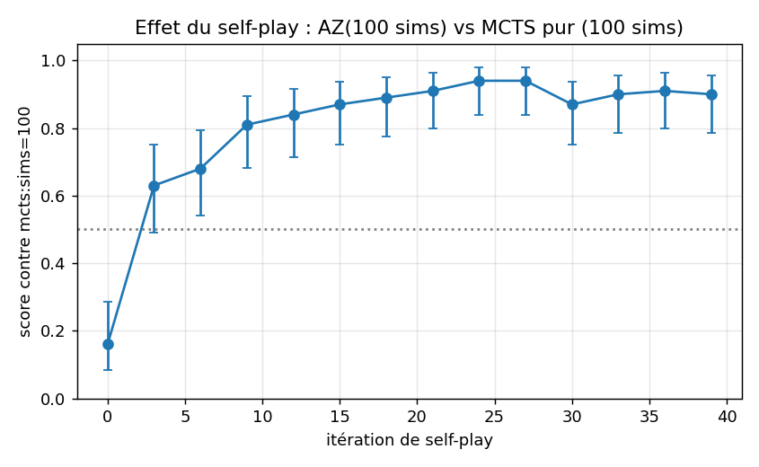

# MCTS et self-play pour jeux à deux joueurs (Puissance 4 → Échecs)

Agent MCTS pur (Niveau 1, Puissance 4) puis AlphaZero simplifié : réseau
policy/value, recherche PUCT et self-play (Niveau 2 : Puissance 4, échecs en
variante allégée, puis échecs complets entraînés sur Modal).

## Démo de stand sur un portable (sans GPU)

Les modèles entraînés sont inclus dans le dépôt (`runs/`) : rien à réentraîner.

```bash
git clone git@github.com:gitmehdii/mcts-selfplay-alphazero.git
cd mcts-selfplay-alphazero
python -m venv .venv
source .venv/bin/activate          # Windows : .venv\Scripts\activate
pip install torch --index-url https://download.pytorch.org/whl/cpu   # PyTorch CPU, plus léger
pip install numpy chess matplotlib
python demo/server.py              # ouvre http://127.0.0.1:8000 (Puissance 4) ; échecs : /echecs
```

La démo tourne sur CPU : environ 0,15 s par coup à Puissance 4 et 0,25 s aux
échecs complets pour l'agent AlphaZero.

## Installation complète

```bash
pip install -r requirements.txt     # numpy, torch, chess (python-chess), matplotlib
python tests/test_all.py            # tests rapides (ou : python -m pytest -q)
```

Un GPU CUDA accélère l'entraînement (Niveau 2) ; tout le reste tourne sur CPU.

## Organisation du code

```
games/
  base.py          interface commune Game (règles, rollout, heuristique, encodage réseau)
  connect4.py      Puissance 4 sur bitboards (~30 000 simulations MCTS/s en Python)
  chess_game.py    échecs via python-chess + variantes allégées (mini, micro, standard)
agents/
  base.py          Random, Heuristic (gagne/bloque ; captures aux échecs), Human
  mcts.py          MCTS pur (UCT) : sélection UCB1, expansion, rollout, rétropropagation
alphazero/
  network.py       réseau résiduel à deux têtes (policy + value)
  mcts.py          MCTS guidé par réseau (PUCT, bruit de Dirichlet, réutilisation d'arbre)
  selfplay.py      self-play en parallèle avec évaluation des feuilles par lots sur GPU
  train.py         boucle self-play -> entraînement -> évaluation
  agent.py         agent de jeu AlphaZero (réseau + PUCT)
arena.py           matchs entre agents (couleurs alternées, multiprocessus, IC de Wilson, Elo)
play.py            CLI : agent vs agent, ou humain vs agent
demo/              démo de stand dans le navigateur (server.py, index.html, chess.html)
modal_app.py       AlphaZero distribué sur Modal : self-play sur 64 cœurs, entraînement GPU
slides_src/        sources du diaporama + outils de validation et d'aperçu
experiments/
  connect4_hparams.py   Niveau 1 : étude des hyperparamètres
  compare_az.py         Niveau 2 : avec vs sans réseau, courbes d'entraînement
```

**Moteurs de jeu.** Pour les échecs on utilise la bibliothèque `python-chess`
(règles complètes). Pour Puissance 4, on utilise une implémentation classique
sur bitboards (technique de J. Tromp) en ~100 lignes, choisie pour sa vitesse :
le MCTS pur passe l'essentiel de son temps dans les rollouts.

## Jouer

Un agent se décrit par une chaîne `type:param=valeur,...` :

| Spécification | Agent |
|---|---|
| `random` | coups uniformément aléatoires |
| `heuristic` | P4 : gagne si possible, sinon bloque, sinon aléatoire. Échecs : capture si possible |
| `human` | saisie au clavier (colonne 1-7, ou coup UCI/SAN aux échecs, `q` pour quitter) |
| `mcts:sims=1000,c=1.41,rollout=random` | MCTS pur ; `rollout=heuristic`, `time_limit=0.5` (s/coup), `max_depth=20` (rollouts tronqués + heuristique) |
| `az:ckpt=runs/connect4/best.pt,sims=100` | AlphaZero : réseau + PUCT ; `sims=0` = réseau seul |

```bash
# humain contre MCTS (Puissance 4)
python play.py --game connect4 --p1 human --p2 mcts:sims=2000 --verbose

# humain contre l'agent AlphaZero entraîné
python play.py --game connect4 --p1 human --p2 az:ckpt=runs/connect4/best.pt,sims=200

# match de 200 parties MCTS vs aléatoire, sur tous les cœurs
python play.py --game connect4 --p1 mcts:sims=200 --p2 random --games 200

# échecs, variante mini : AlphaZero vs MCTS pur à rollouts tronqués
python play.py --game chess:mini --p1 az:ckpt=runs/chess_mini/best.pt,sims=100 \
               --p2 mcts:sims=100,max_depth=20,rollout=captures --games 40
```

## Démo de stand (navigateur)

```bash
python demo/server.py          # Puissance 4 : http://127.0.0.1:8000 · échecs : http://127.0.0.1:8000/echecs
                               # options : --port, --ckpt, --chess-ckpt, --no-browser
```

La démo est servie en local : bibliothèque standard Python et notre code, sans
dépendance de plus. Elle a deux pages, reliées par des onglets.

**Échecs (mini ou complets).** Un sélecteur choisit la variante : l'aile roi
seule, ou les échecs complets avec le modèle entraîné sur Modal
(`runs/modal/chess_standard_v2/`). Échiquier cliquable : on sélectionne une
pièce, les cases possibles s'affichent. Les coups sont notés en français. Trois
adversaires : Instinct (réseau seul), MCTS pur (300 simulations, rollouts
orientés captures) et AlphaZero (réseau + 200 simulations, ≈ 0,2 s par coup).
Le joueur choisit sa couleur. La page affiche :
- les 6 coups les plus explorés par l'IA ;
- la jauge Blancs/Noirs du réseau ;
- l'avancement vers l'arbitrage (100 demi-coups en mini, 200 en complets) et le bilan matériel ;
- la liste des coups.

Un mode spectateur fait jouer AlphaZero contre le MCTS pur.

**Puissance 4.** Quatre niveaux, chacun correspondant à un résultat du projet :

| Niveau | Agent |
|---|---|
| Facile | MCTS pur, 50 simulations |
| Moyen | MCTS pur, 1 000 simulations |
| Instinct | réseau seul, sans recherche |
| Expert | AlphaZero, réseau + 200 simulations (≈ 0,15 s par coup sur CPU) |

Après chaque coup de l'IA, le panneau « Ce que l'IA a pensé » affiche, pour
chaque colonne, la part des simulations, les chances de gagner estimées et
l'intuition du réseau. Une jauge montre qui gagne selon le réseau. Le
**mode spectateur** fait jouer Expert contre Moyen en boucle, pratique quand
personne n'est au stand. Un tableau des scores par niveau est conservé dans le
navigateur. Raccourcis clavier : `1` à `7` pour jouer, `N` pour une nouvelle
partie.

## Niveau 1 — MCTS pur sur Puissance 4

`agents/mcts.py` implémente UCT (Kocsis & Szepesvári, 2006) :

1. **Sélection** : descente en maximisant `Q(s,a) + c·sqrt(ln N(s) / N(s,a))` ;
2. **Expansion** : ajout d'un enfant pour un coup non essayé ;
3. **Simulation** : rollout aléatoire (ou heuristique « gagne/bloque ») jusqu'à la fin ;
4. **Rétropropagation** : chaque nœud cumule la récompense du point de vue du
   joueur qui y a mené (négamax), le parent maximise donc simplement Q.

Le coup joué est l'enfant le plus visité (*robust child*).

```bash
python experiments/connect4_hparams.py     # ~15 min sur 16 cœurs ; --quick pour un essai
```

### Résultats (200 parties par point, couleurs alternées, IC de Wilson à 95 %)

Les CSV et figures sont dans [results/connect4/](results/connect4/). Le score
compte 1 pour une victoire et 0,5 pour un nul.

**E1 — Nombre de simulations contre des adversaires fixes**
([figure](results/connect4/E1_sims_vs_baselines.png))

| Simulations / coup | 1 | 10 | 25 | 50 | 100 | 200 | 1000 |
|---|---|---|---|---|---|---|---|
| vs Random | 52 % | 81 % | 94 % | 98,5 % | 99 % | **100 %** | 100 % |
| vs Heuristic (gagne/bloque) | 4 % | 13 % | 51 % | 72,5 % | 90,5 % | 99 % | **100 %** |

Avec 1 simulation, le MCTS joue au hasard (52 %). Dès 50 simulations
(environ 2 ms par coup), il bat l'aléatoire presque à chaque fois. L'adversaire
« gagne/bloque » demande environ 25 simulations pour être égalé et 200 pour être
dominé.

**E2 — Constante d'exploration c** (300 simulations, contre c = √2)
([figure](results/connect4/E2_exploration_constant.png))

| c | 0 | 0,1 | 0,25 | 0,5 | 1 | √2 | 2 | 3 | 5 |
|---|---|---|---|---|---|---|---|---|---|
| score | 5 % | 9,5 % | 24 % | 37 % | 52 % | 45,5 % | 49,5 % | 47 % | 45,5 % |

Sans exploration (c = 0), la recherche s'enferme sur le premier coup qui a
semblé bon et l'agent perd 95 % des parties. Les performances forment ensuite un
large plateau entre c ≈ 1 et c = 5 : aucune valeur de ce plateau ne se distingue
significativement de √2. Les récompenses sont dans [-1, 1], ce qui explique que
le √2 théorique d'UCB1 tombe déjà dans la bonne zone. Une exploration
insuffisante coûte beaucoup plus cher qu'une exploration excessive.

**E3 — Rendements du calcul** : MCTS(n) contre MCTS(1000)
([figure](results/connect4/E3_sims_vs_mcts1000.png))

| n | 50 | 100 | 250 | 500 | 1000 | 2000 | 4000 | 8000 |
|---|---|---|---|---|---|---|---|---|
| score | 3 % | 10 % | 21,5 % | 34 % | 51,7 % | 62 % | 73,5 % | 82 % |

Chaque doublement du budget rapporte environ +80 à +110 Elo, sans saturation
visible jusqu'à 8000 simulations.

**E4 — Politique de rollout** : rollouts « gagne/bloque » contre rollouts aléatoires

| Budget | 100 sims | 500 sims | 2000 sims | 0,05 s/coup | 0,2 s/coup |
|---|---|---|---|---|---|
| score des rollouts heuristiques | 65 % | 71 % | 65,5 % | 55 % | 54,5 % |

À nombre de simulations égal, des rollouts plus réalistes donnent de meilleures
estimations (+100 à +160 Elo). Mais ils sont environ 4 fois plus lents (E6) : à
temps de réflexion égal, l'avantage tombe à la limite de la significativité.
C'est le compromis classique entre la qualité et la quantité des simulations.

**E5 — Avantage du premier joueur** (MCTS contre lui-même) : le joueur qui commence
gagne 60,5 % (100 sims), 53,5 % (1000) et 55,5 % (4000) des parties. Cela
confirme l'avantage du trait (Puissance 4 est gagné par le premier joueur avec
un jeu parfait) et justifie d'alterner les couleurs dans toutes les mesures.

**E6 — Coût** : environ 26 000 simulations/s avec des rollouts aléatoires et
environ 7 000 avec les rollouts heuristiques (Python, un cœur), soit 0,04 s par
coup à 1000 simulations.

## Niveau 2 — Self-play et réseau de neurones (AlphaZero simplifié)

### Ce qui change par rapport au MCTS pur

| | MCTS pur | AlphaZero |
|---|---|---|
| Évaluation d'une feuille | rollout (aléatoire / heuristique) | tête *value* du réseau `v(s)` |
| Sélection | UCB1 | PUCT : `Q + c_puct·P(s,a)·sqrt(N(s))/(1+N(s,a))` avec `P` = tête *policy* |
| Expansion | un enfant à la fois | tous les enfants, avec leur prior `P` |
| Exploration en self-play | — | bruit de Dirichlet à la racine + température 1 sur les premiers coups |

### Boucle d'entraînement (`alphazero/train.py`)

1. **Self-play** : le réseau courant joue contre lui-même (`--games` parties par
   itération). 256 parties sont jouées en parallèle ; à chaque simulation, les
   feuilles de tous les arbres sont évaluées en un seul lot GPU.
2. Chaque position donne un exemple `(s, π, z)` : `π` = distribution des visites
   MCTS à la racine, `z` = résultat final pour le joueur au trait. Ils vont dans
   un replay buffer à fenêtre glissante (augmenté par symétrie miroir à P4).
3. **Entraînement** : `L = (z - v)² - π·log p` (+ weight decay), AdamW.
4. **Évaluation** régulière contre un MCTS pur fixe ; le meilleur checkpoint est
   sauvegardé dans `best.pt`.

```bash
python -m alphazero.train --game connect4   --out runs/connect4   --iterations 40
python -m alphazero.train --game chess:mini --out runs/chess_mini --sims 50 --games 192
python experiments/compare_az.py --game connect4   --run runs/connect4   --progress-every 5
python experiments/compare_az.py --game chess:mini --run runs/chess_mini --games 40
```

### Adaptation aux échecs

- **Espace d'actions** : 64×64 = 4096 indices `départ·64 + arrivée`, exprimés du
  point de vue du joueur au trait. Les sous-promotions sont retirées (promotion
  en dame uniquement), ce qui ne change pas la légalité des coups.
- **Encodage** (18 plans 8×8) : 6 types de pièces × 2 camps, 4 droits de roque,
  case de prise en passant, avancement de la partie. L'échiquier est retourné
  quand les Noirs jouent, pour que le réseau voie toujours « son » camp en bas.
- **Variante allégée** (`chess:mini`) : l'aile roi seule
  (`4kbnr/4pppp/8/8/8/8/4PPPP/4KBNR`) : roi, fou, cavalier, tour et 4 pions par
  camp, sur l'échiquier 8×8 complet. Aussi : `chess:micro` (roi, tour, 3 pions)
  et `chess:standard`.
- **Longueur limitée** à 100 demi-coups ; à la limite, partie arbitrée au
  matériel (avantage ≥ 3 points) sinon nulle. Sans cela, avec si peu de calcul,
  presque toutes les parties seraient nulles et le réseau n'apprendrait rien.
- **MCTS pur de référence** : rollouts tronqués à 20 demi-coups, avec une
  politique de rollout qui privilégie les captures, puis évaluation matérielle
  `tanh(Δmatériel / 4)` (des rollouts purement aléatoires jusqu'au mat ne
  donnent quasiment aucun signal aux échecs).

### Résultats

Les modèles évalués sont les **derniers checkpoints** (`latest.pt`), pas les
`best.pt`, qui sont choisis sur des évaluations bruitées et seraient donc
biaisés vers le haut. L'agent AlphaZero (AZ) utilise toujours 100 simulations
PUCT par coup. Les couleurs sont alternées et les intervalles sont des IC de
Wilson à 95 %.

#### Puissance 4

Configuration : réseau de 5 blocs résiduels à 64 canaux (0,39 M paramètres),
40 itérations × 256 parties de self-play à 100 simulations, soit 10 240 parties
en environ 55 min sur une RTX 5060 Ti. Résultats dans
[results/connect4/](results/connect4/).

| Duel (100 parties) | V | N | D | Score AZ [IC95] | Elo |
|---|---|---|---|---|---|
| AZ vs aléatoire | 100 | 0 | 0 | 100 % [96-100] | — |
| **AZ vs MCTS pur, mêmes simulations (100)** | 96 | 2 | 2 | **97 %** [92-99] | +604 |
| AZ vs MCTS pur, 5× plus de simulations (500) | 78 | 4 | 18 | 80 % [71-87] | +241 |
| AZ vs MCTS pur, 10× plus de simulations (1000) | 83 | 2 | 15 | 84 % [76-90] | +288 |
| Réseau seul, sans recherche (argmax policy) vs MCTS pur 100 | 84 | 1 | 15 | 84,5 % [76-90] | +295 |
| Réseau **non entraîné** + PUCT vs MCTS pur 100 | 8 | 2 | 90 | 9 % [5-16] | −402 |
| AZ entraîné vs AZ non entraîné | 100 | 0 | 0 | 100 % [96-100] | — |



- **Le gain vient de l'apprentissage, pas de PUCT.** Avec un réseau aléatoire,
  la même recherche PUCT perd 91 % de ses parties contre le MCTS pur. Après
  self-play, elle en gagne 96 %.
- Avec **10 fois moins de simulations**, AZ bat encore nettement le MCTS pur
  (84 %). Le réseau seul, sans aucune recherche (un passage du réseau par
  coup), bat un MCTS à 100 rollouts.
- La courbe de progression (chaque checkpoint contre un MCTS pur à 100
  simulations) montre que l'essentiel du gain arrive dans les 10 premières
  itérations (16 % → 81 %), puis plafonne autour de 90 %.
- **Signes d'un jeu qui s'améliore** ([courbes](results/connect4/training_curves.png)) :
  en self-play, les parties s'allongent (24 → 37 demi-coups) et les nuls
  passent de 4 % à plus de 50 %.

#### Échecs, variante mini

Configuration : même réseau (4,6 M paramètres, l'essentiel dans la couche
policy à 4096 sorties), 24 itérations × 192 parties à 50 simulations, soit
4 608 parties, arrêt au bout de 100 min de budget. Les parties d'échecs sont
environ 3 fois plus longues et chaque simulation coûte environ 10 fois plus
cher qu'à Puissance 4. L'adversaire « MCTS pur » utilise des rollouts de 20
demi-coups orientés captures, suivis d'une évaluation matérielle : il bénéficie
donc d'une connaissance experte. Résultats dans
[results/chess_mini/](results/chess_mini/).

| Duel (60 parties) | V | N | D | Score AZ [IC95] | Elo |
|---|---|---|---|---|---|
| AZ vs aléatoire | 55 | 5 | 0 | 96 % [88-99] | +545 |
| **AZ vs MCTS pur, mêmes simulations (100)** | 35 | 14 | 11 | **70 %** [58-80] | +147 |
| AZ vs MCTS pur, 5× plus de simulations (500) | 8 | 10 | 42 | 22 % [13-34] | −223 |
| AZ vs MCTS pur, 10× plus de simulations (1000) | 2 | 6 | 52 | 8 % [4-18] | −417 |
| Réseau seul (argmax policy) vs aléatoire | 53 | 7 | 0 | 94 % [85-98] | +483 |
| Réseau seul vs MCTS pur 100 | 13 | 14 | 33 | 33 % [23-46] | −120 |
| Réseau **non entraîné** + PUCT vs MCTS pur 100 | 1 | 1 | 58 | 2,5 % [1-10] | −636 |
| AZ entraîné vs AZ non entraîné | 39 | 19 | 2 | 81 % [69-89] | +250 |

Progression des checkpoints contre le MCTS pur à 100 simulations
([figure](results/chess_mini/checkpoint_progress.png)) : 2 % (itération 0) →
15 % (6) → 45 % (12) → 65 % (18) → **72 %** (24). La courbe monte encore
nettement à la fin : l'entraînement n'a pas convergé.

**Lecture.** Le self-play produit ici aussi un gain net et mesurable. Le réseau
non entraîné est quasi nul (2,5 %), le réseau entraîné dépasse le MCTS pur à
budget de simulations égal (70 %), et le réseau seul a appris à jouer bien
mieux que le hasard. En revanche, contrairement à Puissance 4, AZ ne compense
pas encore 5 à 10 fois moins de simulations face à une heuristique matérielle
experte. Avec 4 600 parties, on est très loin des 44 millions de parties
d'AlphaZero pour les échecs complets. Les [courbes d'entraînement](results/chess_mini/training_curves.png)
montrent deux limites :

- **La perte de la policy plafonne** à ≈ 2,0 dès l'itération 12 (contre 0,8 à
  P4), alors que la force mesurée continue de monter. Les cibles π produites
  avec seulement 50 simulations sont bruitées, et la tête policy linéaire à
  4096 sorties est difficile à apprendre.
- **Presque toutes les parties vont jusqu'à la limite** de 100 demi-coups
  (≈ 97 en moyenne) : les parties se décident à l'arbitrage matériel plutôt
  que par mat. L'agent a donc surtout appris à gagner du matériel.

#### Échecs complets, entraînés sur Modal

Le goulot de nos entraînements était le self-play, en Python sur un seul cœur.
`modal_app.py` le distribue sur [Modal](https://modal.com) : à chaque itération,
64 conteneurs CPU jouent 12 parties chacun avec les poids courants (lus dans un
volume Modal), puis un GPU L4 entraîne le réseau sur le replay buffer. On obtient
768 parties toutes les 4 minutes environ, contre 4 608 en 100 minutes en local.

```bash
modal run modal_app.py --run test --budget 0.4 --workers 4 --games-per-worker 2 --sims 16 --steps 20   # test
modal deploy modal_app.py && python -c "import modal_app; modal_app.spawn_detached(run='chess_standard', budget=20)"
modal volume get rl-alphazero runs/chess_standard_v2 runs/modal/
python experiments/eval_modal_chess.py --games 40
```

- **Garde-fous de coût.** Le coût est estimé en continu (tarifs publics Modal,
  majorés) et la boucle s'arrête à 90 % du budget ; le budget est plafonné à
  25 $ dans le code. Sur notre run, l'estimation a suivi la facture réelle à
  quelques centimes près.
- **Robustesse.** Si Modal préempte le conteneur, l'entraîneur reprend tout
  seul depuis son dernier checkpoint. `spawn_detached` lance l'entraînement
  côté serveur, indépendamment de l'ordinateur local.

**Le bug qui bridait l'apprentissage.** Pour aller vite, les copies d'échiquier
utilisées dans la recherche et le self-play ne gardaient pas l'historique des
coups. La répétition de position n'existait donc pas à l'entraînement : une fois
en avance au matériel, l'agent tournait en rond et faisait nulle par répétition
dans les vraies parties. `ChessGame` garde désormais l'historique des positions
depuis le dernier coup irréversible et traite la triple répétition comme une
nulle, comme AlphaZero. Contre le MCTS pur, le score est passé de **67 % à
90 %** dès les itérations suivantes ([courbe](results/chess_standard/progression.png)).

**Résultats** : 24 576 parties au total (15 360 avant la correction, puis 9 216
en reprenant les poids), pour 13,31 $ de calcul réel. Évaluation locale, avec
40 parties par duel et couleurs alternées
([results/chess_standard/](results/chess_standard/)) :

| Duel (AZ à 64 simulations) | V | N | D | Score [IC95] | Elo |
|---|---|---|---|---|---|
| AZ vs aléatoire | 36 | 4 | 0 | 95 % [84-99] | +512 |
| **AZ vs MCTS pur, mêmes simulations** | 32 | 8 | 0 | **90 %** [77-96] | +382 |
| AZ vs MCTS pur, 5× plus de simulations | 29 | 8 | 3 | 82 % [68-91] | +269 |
| **AZ vs MCTS pur, 10× plus de simulations** | 27 | 7 | 6 | **76 %** [61-87] | +203 |
| Réseau seul (sans recherche) vs aléatoire | 6 | 33 | 1 | 56 % [41-70] | +44 |
| Réseau non entraîné + PUCT vs MCTS pur | 5 | 0 | 35 | 12 % [6-26] | −338 |
| AZ entraîné vs AZ non entraîné | 29 | 9 | 2 | 84 % [70-92] | +285 |

Contre l'aléatoire, sur 40 parties, l'agent gagne 16 fois par mat et 13 fois à
l'arbitrage matériel ; 11 parties finissent nulles (9 répétitions, 2 pats). Il
gagne vite du matériel mais **conclut encore mal** : le réseau seul fait nulle
33 fois sur 40. La finition est ce qui s'apprend en dernier.

### Comparaison et limites

| | Puissance 4 | Échecs mini | Échecs complets (Modal) |
|---|---|---|---|
| Parties de self-play | 10 240 | 4 608 | 24 576 |
| AZ vs MCTS pur, simulations égales | 97 % | 70 % | 90 % |
| AZ vs MCTS pur à 10× plus de simulations | 84 % | 8 % | 76 % |
| Réseau non entraîné → entraîné (vs MCTS pur) | 9 % → 97 % | 2,5 % → 70 % | 12 % → 90 % |

Pistes d'amélioration, par ordre d'impact probable :

- **Encore plus de self-play** : la finition (mater) s'apprend en dernier, et
  nous sommes à 24 576 parties contre 44 millions pour AlphaZero.
  `modal_app.py` reprend un run existant avec `init_from`.
- Plus de simulations en self-play (64 → 200) pour des cibles π de meilleure
  qualité : la perte de la policy plafonne.
- Un plan d'entrée « nombre de répétitions », comme AlphaZero, pour que le
  réseau voie lui-même le risque de nulle.
- Une tête policy convolutive (73 plans à la AlphaZero) plutôt que linéaire, et
  un réseau plus profond.

## Références

- Kocsis & Szepesvári, *Bandit based Monte-Carlo Planning*, 2006.
- Browne et al., *A Survey of Monte Carlo Tree Search Methods*, IEEE TCIAIG, 2012.
- Silver et al., *Mastering the game of Go with deep neural networks and tree search*, Nature, 2016.
- Silver et al., *Mastering Chess and Shogi by Self-Play with a General Reinforcement Learning Algorithm*, 2017.
